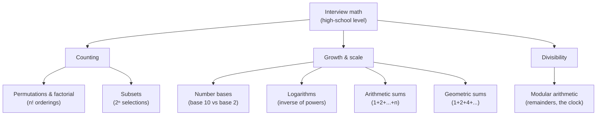
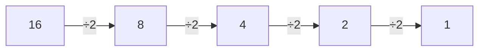
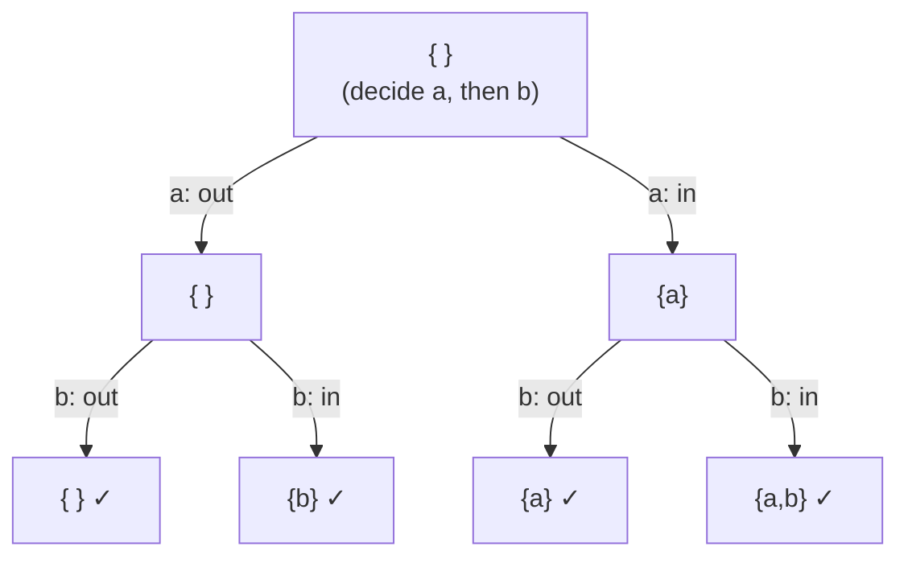
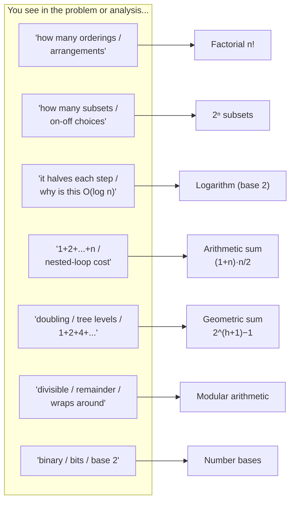

# Math Basics for Interviews (Reviewer)

If these topics feel rusty, start here. This guide assumes you remember ordinary arithmetic but may not
remember what a logarithm, factorial, or modulus means. Every topic follows the same path:

1. **Begin with a familiar idea.** What is happening in plain language?
2. **Walk through a tiny example.** Small numbers make the pattern visible.
3. **Name the formula.** The notation comes after the idea, not before it.
4. **Connect it to code.** What interview clue tells you this idea matters?

You do not need advanced mathematics for most coding interviews. You mainly need seven small tools for
answering questions such as:

- How many possibilities will this algorithm explore?
- How many times can this input be halved?
- How much total work does this loop perform?
- How do I wrap an index or test divisibility?

This reviewer is the math companion to the [Quick DSA Review](quick-dsa-review-reviewer.md). It explains
number bases, [logarithms](algorithms-glossary-reviewer.md#logarithm "A logarithm answers to what power you raise the base to get a number; log2 of 8 is 3."),
[permutations](algorithms-glossary-reviewer.md#permutation "An ordered arrangement of elements; n distinct items have n! permutations."), subsets, arithmetic sequences, geometric sequences, and
[modular arithmetic](algorithms-glossary-reviewer.md#modulo-and-modular-arithmetic "The remainder after division, and doing math while always taking that remainder."). For GCD, primes,
the sieve, fast exponentiation, and overflow, continue to the deeper
[Math & Number Theory](math-and-number-theory-reviewer.md) reviewer after this one feels comfortable.

Related: [Algorithm Patterns Index](algorithm-patterns-index-reviewer.md) · [Quick DSA Review](quick-dsa-review-reviewer.md) · [Complexity & Big-O](complexity-and-big-o-reviewer.md) · [Math & Number Theory](math-and-number-theory-reviewer.md) · [Glossary](algorithms-glossary-reviewer.md)

## Contents
- [How much math do you actually need?](#how-much-math-do-you-actually-need)
- [Number bases and place value](#number-bases-and-place-value)
- [Logarithms: the inverse of exponentials](#logarithms-the-inverse-of-exponentials)
- [Permutations and factorial](#permutations-and-factorial)
- [Subsets and the power set](#subsets-and-the-power-set)
- [Arithmetic sequences](#arithmetic-sequences)
- [Geometric sequences](#geometric-sequences)
- [Modular arithmetic](#modular-arithmetic)
- [Where each idea shows up](#where-each-idea-shows-up)
- [Interview Q&A](#interview-qa)
- [Rapid-fire round](#rapid-fire-round)
- [Exam-style questions](#exam-style-questions)
- [30-second takeaway](#30-second-takeaway)
- [Quick recall checklist](#quick-recall-checklist)
- [References](#references)

> **Suggested first pass:** Read from “How much math do you actually need?” through “Where each idea
> shows up.” Treat the Q&A, rapid-fire round, and exam questions as optional practice for a second pass.

---

## How much math do you actually need?

The short answer is **comfortable high-school arithmetic**: multiplication, division, powers, and
remainders. You do not need calculus, formal proofs, or pages of algebra for the topics in this guide.

The goal is not to perform calculations quickly in your head. The goal is to recognize a pattern:

| When you notice... | Think... | It helps answer... |
| --- | --- | --- |
| the problem halves each step | logarithm | how many steps? |
| every item is included or excluded | subsets / `2ⁿ` | how many choices? |
| every ordering must be tried | permutations / `n!` | is brute force feasible? |
| work grows by a fixed amount | arithmetic sequence | what is the total work? |
| work multiplies each level | geometric sequence | how many tree nodes? |
| values wrap or repeat | modulo | what is the remainder or wrapped index? |
| binary digits or bit flags | base 2 | what does each bit represent? |

You can read the guide in order, but you do not have to master one topic before moving on. First aim to
understand the examples. Return later to memorize the formulas and complexity connections.

**Tiny notation guide:**

- `n` means “the input size” or “how many items,” not one particular number.
- `2ⁿ` (also written `2^n`) means multiply 2 by itself `n` times.
- `log₂(n)` asks which power of 2 reaches `n`.
- `n!` means factorial; the exclamation mark is an operator, not punctuation.
- `a % b` is the remainder after dividing `a` by `b`.
- `O(...)` describes how running time or memory grows; it is not an exact duration.



*The seven ideas grouped by what they do for you: counting how many arrangements/selections exist, gauging how fast something grows, and reasoning about remainders.*

## Number bases and place value

A **[number base](algorithms-glossary-reviewer.md#number-base-radix "The count of distinct digits a numeral system uses; each position is the next power of the base.")** tells you two things: which digits are allowed and how much each position is worth.

Start with the decimal number `352`. You already read it as:

- 3 hundreds = `3 × 100`
- 5 tens = `5 × 10`
- 2 ones = `2 × 1`

Those place values are powers of 10: `100 = 10²`, `10 = 10¹`, and `1 = 10⁰`. Binary uses the exact
same rule, but its place values are powers of 2 because it has only the digits `0` and `1`.

**Walk through binary `1011` from right to left:**

| Bit | Place value | Contribution |
| --- | --- | --- |
| rightmost `1` | `2⁰ = 1` | `1 × 1 = 1` |
| next `1` | `2¹ = 2` | `1 × 2 = 2` |
| `0` | `2² = 4` | `0 × 4 = 0` |
| leftmost `1` | `2³ = 8` | `1 × 8 = 8` |

Add the contributions: `8 + 0 + 2 + 1 = 11`. Therefore binary `1011` means decimal `11`.

**The reusable rule:** reading right to left, positions are `base⁰`, `base¹`, `base²`, and so on. A
digit contributes `digit × base^position`.

**Common mix-up:** `1011` does not mean one thousand eleven when it is labeled binary. The symbols are
the same, but their positions have different values.

**Interview connection:** base 2 appears in bits, masks, subsets, powers of two, and tree sizes. You do
not usually need to convert long numbers by hand; you need to know what a bit in a position means.

**Quick check:** What is binary `1101` in decimal? The active place values are `8`, `4`, and `1`, so the
answer is **13**.

```text
base 10 — each place is a power of 10:

    3      5      2
  10^2   10^1   10^0
   300  +  50  +   2     =  352

base 2 — each place is a power of 2:

    1      0      1      1
   2^3    2^2    2^1    2^0
    8   +   0  +   2  +   1   =  11        (binary 1011 == decimal 11)
```

*Place value is the same idea in both bases: multiply each digit by its position's power and add — only the base of the power changes.*

```csharp
// Evaluate a binary string by place value (Horner's method): value = value*2 + bit.
public static int FromBinary(string bits)
{
    int value = 0;
    foreach (char c in bits)
        value = value * 2 + (c - '0');   // shift left one place, add the new bit
    return value;                         // "1011" -> 11
}
```

**Go deeper →** [Math & Number Theory](math-and-number-theory-reviewer.md#base-conversion-and-place-value) for
general base conversion, and [Bit Manipulation](bit-manipulation-reviewer.md) for working directly in base 2.

## Logarithms: the inverse of exponentials

A **[logarithm](algorithms-glossary-reviewer.md#logarithm "A logarithm answers to what power you raise the base to get a number; log2 of 8 is 3.")** is a step counter. For interviews, the most useful reading is:

> `log₂(n)` asks: “How many times can I halve `n` before I reach 1?”

Take `16`:

1. `16 → 8`
2. `8 → 4`
3. `4 → 2`
4. `2 → 1`

It took four halvings, so `log₂(16) = 4`.

The formal definition says the same thing in reverse: `2⁴ = 16`, so the power needed to turn 2 into 16
is 4. Exponents build upward; logarithms tell you how many building steps occurred.

**When `n` is not an exact power of 2:** do not panic. The logarithm simply is not a whole number:
`log₂(20) ≈ 4.32`. A concrete loop may take four or five iterations depending on how it rounds and when
it stops. Big-O describes the growth pattern, not an exact stopwatch count.

**Why `O(log n)` is fast:** doubling the input adds only one more halving step. A sorted collection can
grow from about 1,000 items to about 1,000,000 items while binary-search steps grow only from roughly 10
to roughly 20.

**Common mix-up:** `O(log n)` does not mean “divide by 2 once.” It means the algorithm repeatedly removes
a constant fraction until very little remains.

**Interview connection:** think logarithm when you see binary search, a balanced-tree height, a heap
height, or a loop that repeatedly divides or multiplies by 2. The log base is omitted in Big-O because
changing bases changes the result only by a constant factor.

**Quick check:** `32 → 16 → 8 → 4 → 2 → 1` is five halvings, so `log₂(32) = 5`.

```text
two ways to read  log2(16) = 4

  as repeated multiplication (exponent):   2 · 2 · 2 · 2  = 16     (four 2's)
  as repeated halving       (logarithm):   16 / 2 / 2 / 2 / 2 = 1  (four halvings)

  n   :   1    2    4    8   16   32   64  ...
  log2:   0    1    2    3    4    5    6   <- each doubling of n adds ONE
```

*Exponentiation builds a number up by repeated multiplication; the logarithm is the count of steps to tear it back down to 1 — which is why halving algorithms cost O(log n).*



*Four halvings carry 16 down to 1, so log₂(16) = 4 — the same four steps binary search takes on a 16-element range.*

```csharp
// floor(log2(n)) by counting halvings until n reaches 1. Requires n >= 1.
public static int Log2Floor(long n)
{
    int count = 0;
    while (n > 1) { n /= 2; count++; }   // each halving is one "log step"
    return count;                         // Log2Floor(16) == 4, Log2Floor(8) == 3
}
```

**Go deeper →** [Complexity & Big-O](complexity-and-big-o-reviewer.md) for the full complexity ladder, and
[Binary Search](binary-search-reviewer.md) for the canonical halving algorithm.

## Permutations and factorial

A **[permutation](algorithms-glossary-reviewer.md#permutation "An ordered arrangement of elements; n distinct items have n! permutations.")** is an arrangement where order matters. Imagine three people—Ana, Ben, and Cy—standing in a
line. `Ana, Ben, Cy` and `Ben, Ana, Cy` count as different lines because the order changed.

Instead of listing every line, count the choices for each position:

1. The first position can hold any of **3** people.
2. After choosing the first, the second position has **2** people left.
3. The final position has **1** person left.

Multiply independent stages: `3 × 2 × 1 = 6` possible lines.

That descending product has a name: **factorial**.

```text
3! = 3 × 2 × 1 = 6
4! = 4 × 3 × 2 × 1 = 24
5! = 5 × 4 × 3 × 2 × 1 = 120
```

The notation `n!` means `n × (n-1) × ... × 1`. By convention, `0! = 1`: there is exactly one way to
arrange nothing—the empty arrangement.

**Permutation or combination?** Ask one question: *If I rearrange the same chosen items, is it a new
answer?* A race podium is a permutation because first and second place differ. Choosing three members
for a committee is a combination because the committee is unchanged when you list its members in a
different order.

**Why factorial matters in code:** it grows extremely quickly. `10! = 3,628,800`, so an algorithm that
tries every ordering is practical only for small inputs. “Return every arrangement” plus a small `n` is
a strong [backtracking](algorithms-glossary-reviewer.md#backtracking "Explore all candidates by building one choice at a time and undoing dead ends.") clue.

**Common mix-up:** factorial counts full orderings of distinct items. It does not automatically answer
“choose a few items without caring about order”; that is a combinations question.

**Quick check:** Four different books can be placed on a shelf in `4! = 24` orders.

```text
all permutations of {a, b, c}  ->  3! = 3 · 2 · 1 = 6

  pos1     pos2     pos3      sequence
   a ────── b ────── c         a b c
     └───── c ────── b         a c b
   b ────── a ────── c         b a c
     └───── c ────── a         b c a
   c ────── a ────── b         c a b
     └───── b ────── a         c b a

  3 choices  ×  2 choices  ×  1 choice  =  6 leaves
```

*Each level fixes one more position, and the branching shrinks 3 → 2 → 1; the leaf count is the product 3·2·1 = 6 = 3!.*

```csharp
// n! = 1·2·…·n. 0! and 1! are 1. Overflows long past 20! — accumulate carefully.
public static long Factorial(int n)
{
    long result = 1;
    for (int i = 2; i <= n; i++) result *= i;   // 5! -> 120
    return result;
}
```

**Go deeper →** [Backtracking](backtracking-reviewer.md) for generating permutations, and
[Math & Number Theory](math-and-number-theory-reviewer.md#combinatorics-basics) for `nCr` and Pascal's triangle.

## Subsets and the power set

A **[subset](algorithms-glossary-reviewer.md#subset "Any selection from a set; n elements have 2^n subsets including empty and full.")** is any selection taken from a set. If the original set is `{a, b}`, its subsets are:

```text
{}        choose neither item
{a}       choose only a
{b}       choose only b
{a, b}    choose both items
```

The empty selection `{}` counts, and the full selection `{a, b}` counts.

Why are there `2ⁿ` subsets? Process one element at a time. For each element, you make exactly two
choices:

- leave it out;
- include it.

For `{a, b}`, that is `2 × 2 = 4` outcomes. For `{a, b, c}`, it is `2 × 2 × 2 = 8`. With `n` elements,
it is `2ⁿ`.

**A useful way to see the doubling:** begin with one subset, `{}`. Adding `a` makes a second version with
`a`: `{}`, `{a}`. Adding `b` copies both existing subsets and adds `b` to each copy, producing four.
Every new element doubles the list.

**How this becomes a bitmask:** assign one bit to each element. `0` means “out” and `1` means “in.” For
`{a, b, c}`, the mask `101` means include `a`, exclude `b`, and include `c`. All binary masks from `000`
through `111` represent the eight subsets.

**Common mix-up:** a subset is a selection, not an ordering. `{a, b}` and `{b, a}` are the same subset.

**Interview connection:** “generate all subsets,” “choose any group,” and “include or exclude each item”
point to a `2ⁿ` search, often implemented with backtracking or bitmasks. Because the count doubles with
every new item, exhaustive subset solutions commonly require `n` around 20 or smaller.

**Quick check:** A four-element set has `2⁴ = 16` subsets.

```text
each element is a switch: ON (in the subset) or OFF (out)

  elements     states (2^n)     the subsets
  --------------------------------------------------------------------
  {a}            2^1 = 2         {}, {a}
  {a,b}          2^2 = 4         {}, {a}, {b}, {a,b}
  {a,b,c}        2^3 = 8         {}, {a}, {b}, {c}, {a,b}, {a,c}, {b,c}, {a,b,c}

  n elements  ->  2^n subsets    (counting the empty set and the full set)
```

*Adding one element doubles the number of subsets, because that element can be flipped on or off independently of all the others — the source of the 2ⁿ.*



*Two yes/no decisions for the set {a, b} produce 2² = 4 leaf subsets — one branch per independent include/exclude choice.*

```csharp
// number of subsets of an n-element set = 2^n. 1L << n is 2^n via a bit shift.
public static long CountSubsets(int n) => 1L << n;   // CountSubsets(3) == 8
```

**Go deeper →** [Backtracking](backtracking-reviewer.md) for generating the power set, and
[Bit Manipulation](bit-manipulation-reviewer.md) for iterating subsets as bitmasks.

## Arithmetic sequences

An **[arithmetic sequence](algorithms-glossary-reviewer.md#arithmetic-sequence "A sequence with a constant difference between consecutive terms; its sum is (first+last)·count/2.")** changes by adding the same amount each time.

```text
2, 5, 8, 11, 14     add 3 each time -> arithmetic
1, 2, 4, 8, 16      multiply by 2    -> not arithmetic
```

Be careful to separate two questions:

- **What is a particular term?** Keep adding the common difference.
- **What is the sum of all terms?** Add the sequence together, often using a formula.

For the sum `1 + 2 + 3 + 4 + 5`, pair numbers from the ends:

```text
first + last       = 1 + 5 = 6
second + next-last = 2 + 4 = 6
middle             = 3
total              = 15
```

Every end-to-end pair has the same average: `(first + last) / 2`. Multiply that average by the number of
terms:

```text
sum = (first + last) × count / 2
    = (1 + 5) × 5 / 2
    = 15
```

**Why this appears in algorithms:** consider an inner loop that runs once on the first outer iteration,
twice on the second, and so on. Its work is `1 + 2 + ... + n`, not `n × n` exactly. The formula gives
`n(n + 1) / 2`, whose dominant term is `n² / 2`, so the complexity is **O(n²)**.

**Common mix-up:** “constant difference” describes arithmetic sequences; it does not mean all terms are
the same. The terms may rise or fall, but the amount added each time stays constant.

**Quick check:** `3 + 5 + 7 + 9` has first `3`, last `9`, and count `4`, so its sum is
`(3 + 9) × 4 / 2 = 24`.

```text
nested loop whose inner body runs 1, 2, 3, ..., n times:

  for (i = 0; i < n; i++)
      for (j = 0; j <= i; j++)      <- runs i+1 times
          doSomething();

   i = 0    *                          1
   i = 1    * *                        2
   i = 2    * * *                      3
    ...                               ...
   i = n-1  * * * ........ *           n
                                  ------------
   total = 1 + 2 + ... + n = (1 + n)·n / 2 = (n² + n)/2  ->  O(n²)
```

*The work forms a triangle of height n; its area — the arithmetic sum (1+n)·n/2 — is dominated by the n² term, so the loop is O(n²).*

```csharp
// Sum of an arithmetic sequence from its first term, last term, and term count.
public static long SumArithmetic(long first, long last, long count)
    => (first + last) * count / 2;     // SumArithmetic(1, 5, 5) == 15
```

**Go deeper →** [Complexity & Big-O](complexity-and-big-o-reviewer.md) for reading running time off code,
where this triangular sum appears constantly.

## Geometric sequences

A **[geometric sequence](algorithms-glossary-reviewer.md#geometric-sequence "A sequence with a constant ratio between consecutive terms; its sum is first·(rⁿ−1)/(r−1).")** changes by multiplying by the same amount each time.

```text
1, 2, 4, 8, 16      multiply by 2 each time -> geometric
3, 9, 27, 81        multiply by 3 each time -> geometric
1, 2, 6, 24         multipliers change      -> not geometric
```

The fixed multiplier is called the **ratio**. Arithmetic sequences have a constant difference;
geometric sequences have a constant ratio.

The most important interview example is doubling:

```text
1 + 2 + 4 + 8 = 15
the next power is 16
so the sum is 16 - 1
```

In general, `1 + 2 + 4 + ... + 2^h = 2^(h+1) - 1`. You can remember this special doubling rule first;
the general formula can come later:

```text
sum = first × (ratio^count - 1) / (ratio - 1), when ratio != 1
```

For `1, 2, 4, 8`, the first term is 1, the ratio is 2, and there are 4 terms:
`1 × (2⁴ - 1) / (2 - 1) = 15`.

**Why this appears in trees:** a perfect binary tree has 1 node at level 0, 2 at level 1, 4 at level 2,
and so on. Each level doubles, so the total node count is a geometric sum. A height-3 perfect tree has
`1 + 2 + 4 + 8 = 15` nodes.

**Common mix-up:** `2^h` counts nodes on level `h`; `2^(h+1) - 1` counts all nodes from the root through
level `h`. Also check whether a problem calls the root height 0 or height 1 before using a formula.

**Quick check:** A perfect binary tree with levels containing `1, 2, 4, 8, 16` nodes has
`1 + 2 + 4 + 8 + 16 = 31` total nodes.

```text
nodes per level in a perfect binary tree double each level (ratio 2):

  level 0:            ( )                    1   = 2^0
  level 1:        ( )     ( )                2   = 2^1
  level 2:      ( ) ( )  ( ) ( )             4   = 2^2
  level 3:    ( )( )( )( )( )( )( )( )        8   = 2^3
                                          --------
  total = 1 + 2 + 4 + 8 = 15 = 2^4 - 1   (height-3 tree has 2^(h+1) - 1 nodes)

  geometric sum:  first·(ratio^n - 1)/(ratio - 1) = 1·(2^4 - 1)/(2 - 1) = 15
```

*Levels grow geometrically with ratio 2, so the node total is the geometric sum 2^(h+1) − 1 — and the bottom level alone holds more nodes than all the levels above it combined.*

```csharp
// Sum of a geometric sequence: first, first·r, first·r², ... (n terms).
// Closed form first·(rⁿ - 1)/(r - 1) for r != 1; if r == 1 every term equals first.
public static long SumGeometric(long first, long ratio, int n)
{
    if (ratio == 1) return first * n;
    long rPowN = 1;
    for (int i = 0; i < n; i++) rPowN *= ratio;     // ratioⁿ
    return first * (rPowN - 1) / (ratio - 1);        // SumGeometric(1, 2, 5) == 31
}
```

**Go deeper →** [Trees & Binary Search Trees](trees-and-binary-search-trees-reviewer.md) and
[Heaps & Priority Queues](heaps-and-priority-queues-reviewer.md), where this node-counting recurs.

## Modular arithmetic

The `%` operator gives the **remainder** after whole-number division.

```text
17 / 5 = 3 remainder 2

5 fits into 17 three whole times: 3 × 5 = 15
2 is left over
therefore 17 % 5 = 2
```

**[Modular arithmetic](algorithms-glossary-reviewer.md#modulo-and-modular-arithmetic "The remainder after division, and doing math while always taking that remainder.")** focuses on that remainder. The number after `%` is the **modulus**—the size of the cycle.

**Think of a clock.** On a 12-hour clock, counting 5 hours forward from 10 lands on 3:

```text
(10 + 5) % 12 = 15 % 12 = 3
```

Values wrap back to 0 after reaching the modulus. Arrays use the same idea. For an array of length 5,
`(index + 1) % 5` moves `0 → 1 → 2 → 3 → 4 → 0`, making a circular index.

**Divisibility is the zero-remainder case.** If `n % x == 0`, nothing is left over, so `x` divides `n`
evenly. For example, `18 % 3 == 0`, but `18 % 4 == 2`.

**Reducing large values early:** remainder arithmetic lets you reduce pieces before combining them:

```text
(a + b) % m = ((a % m) + (b % m)) % m
(a × b) % m = ((a % m) × (b % m)) % m
```

For example, `(27 + 38) % 10` can be simplified to `(7 + 8) % 10 = 5`. This is why algorithms that
request an answer “modulo `1,000,000,007`” can keep intermediate values smaller.

**Negative values need care.** Languages disagree about the sign of a negative remainder. In C#,
`-1 % 5 == -1`. When you need a wrapped result in the range `0` through `m - 1`, normalize it with
`((x % m) + m) % m`.

**Common mix-up:** `%` is not percentage. It is the remainder operator in the code shown here.

**Interview connection:** think modulo for circular buffers, alternating patterns, even/odd checks,
divisibility, hashing into buckets, and answers that must remain within a fixed numeric range.

**Quick check:** `29 % 6 = 5`, because `6 × 4 = 24` and `29 - 24 = 5`.

```text
x % y by repeated subtraction (the definition):  32 % 12

  32 >= 12 ?  yes -> 32 - 12 = 20
  20 >= 12 ?  yes -> 20 - 12 =  8
   8 >= 12 ?  no  -> stop, answer = 8        (32 % 12 == 8)

distributivity:  (13 + 2) % 12 = 15 % 12 = 3
              = ((13 % 12) + (2 % 12)) % 12 = (1 + 2) % 12 = 3
```

*Modulo is "subtract the modulus until you can't," and distributivity lets you take the remainder of each part first — the trick that stops big sums and products from overflowing.*

```csharp
// Conceptual definition of x % y by repeated subtraction (x >= 0, y > 0).
// Real code uses the % operator, which computes this in O(1).
public static int Mod(int x, int y)
{
    while (x >= y) x -= y;
    return x;                               // Mod(32, 12) == 8
}

// Primality the math-basics way: any composite n has a divisor in [2, sqrt(n)].
public static bool IsPrime(int n)
{
    if (n < 2) return false;                // 1 is not prime
    for (int x = 2; (long)x * x <= n; x++)  // (long) cast keeps x*x from overflowing
        if (n % x == 0) return false;       // divisible -> composite
    return true;                            // IsPrime(17) == true, IsPrime(15) == false
}
```

**Go deeper →** [Math & Number Theory](math-and-number-theory-reviewer.md#modular-arithmetic-and-the-1e97-convention)
for the `1e9+7` convention and modular inverses, and the [sieve](math-and-number-theory-reviewer.md#sieve-of-eratosthenes)
for finding many primes at once.

## Where each idea shows up

Most of the value of these seven ideas is recognizing the cue in a problem (or in your own running-time
analysis) and reaching for the right formula.



*From a phrase in the prompt — or a shape in your loop — to the formula that quantifies it: orderings, selections, halvings, triangular sums, doubling sums, remainders, or bases.*

## Interview Q&A

### Counting

Q: How many ways can you arrange `n` distinct items in a row, and what is that called?
A: `n!` ("n factorial") = `n × (n-1) × … × 1`. The first slot has `n` choices, the next `n-1`, and so on, so the orderings multiply. For example `5! = 120`. Because `n!` grows faster than any exponential, "list all arrangements" is only feasible for tiny `n` (≈ 10), which is itself a hint that backtracking is intended.

Q: A set has `n` elements — how many subsets does it have, and why?
A: `2ⁿ`. Each element is an independent in-or-out choice, so the choices multiply: `2 × 2 × … × 2`. This counts the empty set and the full set. The same fact is why an `n`-bit bitmask represents one subset, and why subset/bitmask problems cap out near `n = 20`.

Q: What is the difference between a permutation and a combination?
A: A permutation cares about order — `[a, b]` and `[b, a]` are different — so there are more of them (`n!` for a full arrangement). A combination ignores order — `{a, b}` and `{b, a}` are the same — so there are fewer. The test: does reordering the same elements count as a new answer? If yes, permutation.

### Growth and bases

Q: Explain `log₂(n)` in one sentence, two ways.
A: It is the power you raise 2 to in order to get `n` (since `2³ = 8`, `log₂ 8 = 3`), and equivalently the number of times you can halve `n` before reaching 1. The halving reading is why binary search, balanced trees, and heaps are all `O(log n)`.

Q: Why does Big-O never specify the base of a logarithm?
A: Changing the base only multiplies the value by a constant (`logₐ n = log_b n / log_b a`), and Big-O ignores constant factors. So `log₂ n`, `log₁₀ n`, and `ln n` are all the same complexity class — just write `O(log n)`.

Q: Convert binary `1011` to decimal and explain the method.
A: 11. Each position from the right is a power of 2: `2⁰ = 1`, `2¹ = 2`, `2² = 4`, `2³ = 8`. The bits `1011` switch on the 8, 2, and 1 places: `8 + 0 + 2 + 1 = 11`. It is the same place-value rule as base 10, with 2 in place of 10.

### Sums and divisibility

Q: A loop's inner body runs `1, 2, 3, …, n` times across the outer iterations. What is the total, and the Big-O?
A: `1 + 2 + … + n = (1 + n) × n / 2 = (n² + n)/2`. That is an arithmetic-sequence sum; dropping the lower-order term and the constant gives **O(n²)**. This triangular sum is the reason so many nested loops are quadratic.

Q: How many nodes are in a perfect binary tree of height `h`, and how do you get it?
A: `2^(h+1) − 1`. The levels hold `1, 2, 4, …, 2^h` nodes — a geometric sequence with ratio 2 — and that sum is `2^(h+1) − 1`. A useful corollary: the last level alone has more nodes than all the levels above it combined, so roughly half of all nodes are leaves.

Q: State the distributive property of modular arithmetic and say why it is useful.
A: `(a + b) % c = ((a % c) + (b % c)) % c` (and the same for multiplication). It lets you take the remainder of each operand *before* combining, so a running total or product never grows large enough to overflow — exactly what "give the answer modulo 1e9+7" problems require.

Q: How do you test whether `x` divides `n`, and how does that give a primality check?
A: `x` divides `n` exactly when `n % x == 0`. A number `n` is prime if no `x` in `[2, √n]` divides it — you only need to go up to `√n` because any factor larger than the square root pairs with a smaller one already tested.

## Rapid-fire round

- Number of orderings of `n` items → **`n!` (factorial).**
- `5!` → **120.**
- Number of subsets of an `n`-set → **`2ⁿ` (includes empty and full).**
- Subsets of `{a, b, c}` → **8.**
- `log₂(n)` in words → **power of 2 that gives `n` / number of halvings to reach 1.**
- `log₂(16)` → **4.**
- Binary `1011` in decimal → **11 (`8 + 2 + 1`).**
- Why base 2 for computers → **circuits are on/off — two states.**
- Arithmetic sum formula → **`(first + last) × count / 2`.**
- `1 + 2 + … + n` → **`n(n+1)/2`, which is O(n²) as a loop bound.**
- Geometric sum formula → **`first × (ratioⁿ − 1) / (ratio − 1)`.**
- `1 + 2 + 4 + … + 2^h` → **`2^(h+1) − 1`.**
- Nodes in a perfect binary tree of height `h` → **`2^(h+1) − 1`.**
- `%` meaning → **remainder after division.**
- Modular distributivity → **`(a + b) % c = ((a % c) + (b % c)) % c`.**
- Test "does `x` divide `n`" → **`n % x == 0`.**
- Primality trial-division range → **`[2, √n]`.**
- C# negative remainder fix → **`((x % m) + m) % m`.**
- Does Big-O care about log base? → **No — constant factor, write `O(log n)`.**

## Exam-style questions

1. What do these print, and what real-world quantity does each count?

```csharp
Console.WriteLine(MathBasics.Factorial(5));
Console.WriteLine(MathBasics.CountSubsets(3));
```

**Answer:** `120` then `8`. `Factorial(5) = 5 × 4 × 3 × 2 × 1 = 120` is the number of ways to **order** 5
distinct items. `CountSubsets(3) = 2³ = 8` is the number of **subsets** of a 3-element set (each element
in or out), counting the empty set and the full set.

2. A function runs the inner statement `1, 2, 3, …, n` times. What is the total number of executions for
   `n = 10`, and the asymptotic complexity?

```csharp
Console.WriteLine(MathBasics.SumArithmetic(1, 10, 10));
```

**Answer:** `55`. The total is the arithmetic sum `1 + 2 + … + 10 = (1 + 10) × 10 / 2 = 55`. As a
function of `n` it is `(n² + n)/2`, which is **O(n²)** after dropping the lower-order term and the
constant — the standard reason a triangular nested loop is quadratic.

3. What does this return, and what does it tell you about a perfect binary tree?

```csharp
Console.WriteLine(MathBasics.SumGeometric(1, 2, 4));
```

**Answer:** `15`. It is the geometric sum `1 + 2 + 4 + 8 = 2⁴ − 1 = 15`. Read as tree levels
(`1, 2, 4, 8` nodes), it says a perfect binary tree of height 3 has 15 nodes — matching the general
formula `2^(h+1) − 1`.

4. Trace these and explain the modular results.

```csharp
Console.WriteLine(MathBasics.Mod(32, 12));
Console.WriteLine(MathBasics.IsPrime(17));
Console.WriteLine(MathBasics.IsPrime(15));
```

**Answer:** `8`, `True`, `False`. `Mod(32, 12)` subtracts 12 twice (`32 → 20 → 8`) and stops once `8 < 12`,
so `32 % 12 = 8`. `IsPrime(17)` finds no divisor in `[2, 4]` (`4 × 4 = 16 ≤ 17`, but `5 × 5 > 17` stops
the loop), so 17 is prime. `IsPrime(15)` hits `15 % 3 == 0`, so 15 is composite.

5. Without running it, what does `MathBasics.Log2Floor(1024)` return, and what does the value mean?

**Answer:** `10`. `1024 = 2¹⁰`, so it takes ten halvings to bring 1024 down to 1
(`1024 → 512 → … → 1`). That is `floor(log₂ 1024) = 10`, the number of steps binary search would take on a
1024-element sorted range.

6. In C#, what is `-7 % 3`, and how do you get a non-negative remainder in `[0, 3)`?

**Answer:** `-1`, because C#'s `%` takes the sign of the dividend. Normalize with `((x % m) + m) % m`:
`((-7 % 3) + 3) % 3 = ((-1) + 3) % 3 = 2`. This matters whenever you index circularly or accumulate under
a modulus and a subtraction can go negative.

## 30-second takeaway

> Interview math is **high-school level** — seven small ideas, mostly used to *estimate cost*.
> **Number bases:** each place is a power of the base; binary `1011` = `8 + 2 + 1` = 11. **Logarithms:**
> `log₂ n` is the power of 2 that gives `n`, equivalently the number of halvings to reach 1 — the source
> of every `O(log n)`. **Permutations:** `n!` orderings, exploding past `n ≈ 10` (backtracking territory).
> **Subsets:** `2ⁿ` of them (each element in or out), the bitmask cap near `n = 20`. **Arithmetic sum:**
> `(first + last) × count / 2`; `1 + 2 + … + n` is `n(n+1)/2`, which makes triangular nested loops
> **O(n²)**. **Geometric sum:** `first × (ratioⁿ − 1)/(ratio − 1)`; `1 + 2 + 4 + … + 2^h = 2^(h+1) − 1`,
> the node count of a perfect binary tree. **Modular arithmetic:** `%` is the remainder, it wraps like a
> clock, and `(a + b) % c = ((a % c) + (b % c)) % c` keeps big totals from overflowing; `n % x == 0`
> tests divisibility, the basis of the `[2, √n]` primality check.

## Quick recall checklist

- **Number base / place value:** each position is `base^k`; binary `1011` = `8 + 0 + 2 + 1` = 11; base 2
  because circuits are on/off.
- **Logarithm:** `log₂ n` = power of 2 giving `n` = halvings to reach 1; `log₂ 16 = 4`; base is
  irrelevant in Big-O (`O(log n)`).
- **Permutations / factorial:** `n!` orderings; `5! = 120`; grows past exponential, so "all orderings"
  means small `n` and backtracking.
- **Subsets:** `2ⁿ` subsets (each element in/out, includes `{}` and full set); maps to an `n`-bit mask;
  caps `n ≈ 20`.
- **Arithmetic sequence:** constant difference; sum `(first + last) × count / 2`; `1 + 2 + … + n =
  n(n+1)/2` → **O(n²)** loop bound.
- **Geometric sequence:** constant ratio; sum `first × (ratioⁿ − 1)/(ratio − 1)`; `1 + 2 + 4 + … + 2^h =
  2^(h+1) − 1` = perfect-binary-tree node count.
- **Modular arithmetic:** `%` = remainder, wraps at the modulus; distributive `(a + b) % c =
  ((a % c) + (b % c)) % c`; divisibility `n % x == 0`; primality tests `[2, √n]`; fix negatives with
  `((x % m) + m) % m`.

## References

- AlgoMonster — [Math for Technical Interviews](https://algo.monster/problems/math-basics) (the page this reviewer mirrors).
- Wikipedia — [Logarithm](https://en.wikipedia.org/wiki/Logarithm), [Factorial](https://en.wikipedia.org/wiki/Factorial), [Power set](https://en.wikipedia.org/wiki/Power_set).
- Wikipedia — [Arithmetic progression](https://en.wikipedia.org/wiki/Arithmetic_progression), [Geometric progression](https://en.wikipedia.org/wiki/Geometric_progression).
- Wikipedia — [Modular arithmetic](https://en.wikipedia.org/wiki/Modular_arithmetic), [Binary number](https://en.wikipedia.org/wiki/Binary_number).
- NeetCode — [Roadmap](https://neetcode.io/roadmap) (Math &amp; Geometry section).
- See also the deeper [Math & Number Theory](math-and-number-theory-reviewer.md) reviewer in this suite.
